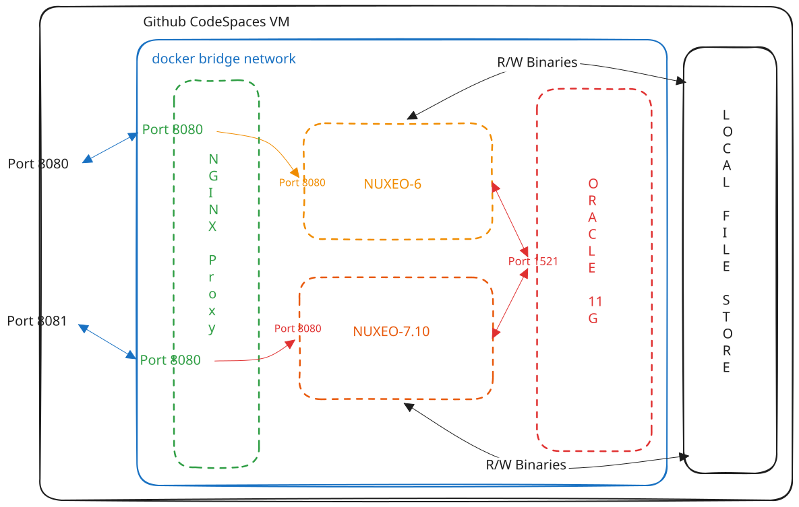

# Nuxeo Migration — 6.0 → 7.10 (LTS 2015)

A self-contained Docker environment to simulate and validate an upgrade from **Nuxeo 6.0** to **Nuxeo 7.10 (LTS 2015)**, both backed by **Oracle 11g XE**.

## Current Architecture



[Open the editable architecture diagram source](diagrams/n6_710.excalidraw).

This is not a production deployment. It is a mock environment used to:

- Validate that the N6 Oracle schema can be cloned and migrated to N7
- Verify that documents, users, and binary files created in N6 are accessible in N7 after migration
- Test the required `CONTENT.DATA` column change (`VARCHAR2(40)` → `VARCHAR2(250)`) documented in the [Nuxeo 6.0 → LTS 2015 upgrade guide](https://doc.nuxeo.com/nxdoc/upgrade-from-60-to-lts-2015/)

## Prerequisites

- Docker
- `ojdbc6.jar` placed in `./ojdbc/` (Oracle licensing prevents bundling)

```bash
curl -L https://repo1.maven.org/maven2/com/oracle/database/jdbc/ojdbc6/11.2.0.4/ojdbc6-11.2.0.4.jar -o ojdbc/ojdbc6.jar
```

## Quick Start

```bash
cp .env.example .env        # fill in credentials
docker compose --profile n6 up -d  # starts Oracle + Nuxeo 6 + Nginx
```

Nuxeo 6 → http://localhost:8080/nuxeo

## Public URLs

Before starting either profile, you **must** set its public URL in `.env`:
`NUXEO6_URL` for N6 and `NUXEO7_URL` for N7. Each value must be the externally
reachable URL for that Nuxeo instance and include the `/nuxeo` context path.
In Codespaces, use the forwarded URL for the matching published port (8080 for
N6 and 8081 for N7), for example `https://<forwarded-host>/nuxeo`. For local-only
access, use `http://localhost:8080/nuxeo` for N6 and
`http://localhost:8081/nuxeo` for N7. Update both values whenever the public
URLs or forwarded hostnames change; Nginx uses them to generate correct public
URLs inside Nuxeo.

Nginx is the only service publishing the Nuxeo ports. The N6 and N7 services
are isolated behind their respective profiles; Nginx is included in both.
Start N6 with `--profile n6` or N7 with `--profile n7`.

<details>
<summary>Request path</summary>

In Codespaces, the request travels through these components:

```text
Browser --HTTPS--> Codespaces forwarding --HTTP--> Nginx:8080
				--HTTP over the Docker network--> nuxeo6:8080 (Nuxeo)
```

The public HTTPS port is 443. Port 8080 is the internal application/proxy
listener; a `-8080` suffix in the Codespaces hostname is part of the hostname,
not an explicit URL port.

</details>

<details>
<summary>Why Nuxeo needs the nuxeo-virtual-host header</summary>

### Why Nuxeo Added `:80`

Nuxeo 6 reconstructs some public URLs from the incoming request and proxy
headers. Its Java utility
`org.nuxeo.ecm.platform.web.common.vh.VirtualHostHelper` is used by authentication
and other application code to construct absolute URLs.

Without a `nuxeo-virtual-host` request header, the helper follows this sequence:

1. Read the hostname, port, and scheme from the incoming request.
2. Override the port with `X-Forwarded-Port`, if provided and parseable.
3. Override the scheme with `X-Forwarded-Proto`, if provided.
4. Read `X-Forwarded-Host`. If it contains an explicit port, use that port.
	 Otherwise, set the port to **80**, regardless of the scheme or the port
	 previously obtained from the request or `X-Forwarded-Port`.
5. Construct the public origin and append the application context path.

For example, these headers trigger the problem:

```http
X-Forwarded-Host: your-public-host.app.github.dev
X-Forwarded-Proto: https
X-Forwarded-Port: 443
```

Step 4 changes the port from 443 to 80 while leaving the scheme as HTTPS.
Since 80 is not HTTPS's default port, the helper explicitly includes it:

```text
https://your-public-host.app.github.dev:80/nuxeo/...
```

This is **Nuxeo's URL reconstruction**, not a port added by the proxy. Setting
`nuxeo.url` or sending `X-Forwarded-Port: 443` does not bypass this code path.

Direct requests to the filter-free backend reproduced the distinction:

| Forwarded host header | Resulting HTTPS redirect |
| --- | --- |
| No `X-Forwarded-Host` | Correct public URL from the incoming request metadata |
| `X-Forwarded-Host: hostname` | Incorrect `https://hostname:80/nuxeo/...` |
| `X-Forwarded-Host: hostname:443` | Correct `https://hostname/nuxeo/...` |

### How Nginx Prevents the Bad Redirect

Nginx uses Nuxeo's supported `nuxeo-virtual-host` **request header** to provide
the complete public origin before Nuxeo reconstructs any URLs:

1. Compose passes `NUXEO6_URL` into the proxy as `NUXEO_PUBLIC_URL`.
2. The official Nginx image renders `nginx/nuxeo6.conf` from a template on startup.
	 `NGINX_ENVSUBST_FILTER` limits substitution to that environment variable,
	 leaving Nginx variables such as `$nuxeo_origin` intact.
3. The first `map` extracts the origin, including any explicit public port,
	 while removing `/nuxeo` and other path components.
4. Nginx overwrites the upstream header on every proxied request:

	 ```nginx
	 proxy_set_header nuxeo-virtual-host $nuxeo_origin/;
	 ```

For `NUXEO6_URL=https://your-public-host.app.github.dev/nuxeo`, Nuxeo receives:

```http
nuxeo-virtual-host: https://your-public-host.app.github.dev/
```

`VirtualHostHelper` gives this header priority and skips the faulty
forwarded-header reconstruction. Nuxeo appends its own `/nuxeo` context path,
so the header must contain the origin with a trailing slash, **not** the full
application URL including `/nuxeo`.

The origin comes from deployment configuration, not a client-supplied hostname.
Even an incoming `nuxeo-virtual-host: https://untrusted.invalid/` is replaced.
The other forwarded headers are still sent, but they no longer determine URLs
on this helper's virtual-host path. The existing map that strips a trailing
`:80` from the forwarded hostname is not sufficient by itself: a bare hostname
still triggers Nuxeo's default-to-80 behavior.

`proxy_redirect off` leaves Nuxeo's `Location` headers unchanged. There is no
response-body substitution or redirect URL repair: the application generates
the correct URL in the first place. Requests made through localhost also redirect
to the configured public origin, so use that public URL for the browser session.

</details>

<details>
<summary>JavaScript MIME fix</summary>

After redirects worked, modern browsers rejected a script bundle at
`/nuxeo/js/?scripts=...` because its response had no `Content-Type` header.
Nuxeo 6's `AggregatedJSProvider` servlet returned HTTP 200 with real JavaScript
but wrote the body without setting a MIME type. The static `.js` mapping does not
fix a response generated by this servlet.

Nginx handles this separately in the `/nuxeo/js/` location:

- A `map` selects `application/javascript` only when the upstream status is
	**200** and its `Content-Type` is empty; otherwise it selects the upstream type.
- `proxy_hide_header Content-Type` and `add_header Content-Type $js_content_type`
	emit the selected value without duplicating an existing MIME header.
- The JavaScript body is unchanged. HTML pages are outside this location, and
	error responses are not relabeled as JavaScript.

This lets the browser execute the bundle without disabling strict MIME checking.
The proxied bundle's MIME type and script body, ordinary HTML content type,
and HTTPS redirects were checked. The application was also confirmed working
through the public URL in the browser.

</details>

### Switching and Troubleshooting

After changing the public URL, recreate the app and Nginx under the matching
profile. For N6:

```bash
docker compose --profile n6 up -d --force-recreate
```

To validate the generated Nginx configuration and inspect request traces:

```bash
docker exec nuxeo-6-proxy nginx -t
docker compose --profile n6 logs --tail=50 nginx-proxy
```

The proxy's JSON access logs include incoming forwarded headers, upstream status,
and both upstream and outgoing redirect locations. A correct upstream location
without `:80` confirms that Nuxeo generated the right redirect before the response
passed back through Nginx.

## Migration Steps

```bash
# 1. Populate N6 — upload files, create users
# 2. Clone schema and binaries to N7
./scripts/clone-schema-to-owner7.sh

# 3. Start Nuxeo 7.10 behind Nginx on port 8081
docker compose --profile n7 up -d
```

Nuxeo 7.10 → http://localhost:8081/nuxeo

Nginx listens on host port `NUXEO7_PORT` (8081 by default) and forwards those
requests to the internal `nuxeo7:8080` service. Set `NUXEO7_URL` to the public
port-8081 URL ending in Nuxeo's actual `/nuxeo` context path. Nginx uses that
URL's origin for N7's `nuxeo-virtual-host` header and applies the same aggregated
JavaScript MIME fallback used on the N6 listener. Nginx has both `n6` and `n7`
profiles, so either app profile starts the shared proxy. It has no hard dependency
on N6; the corresponding Nuxeo service is selected by the profile.
